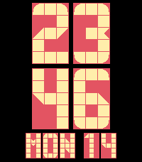
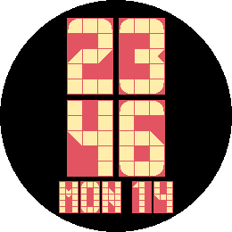

# Transit

*Big tiled digits on coloured plates, like a station display, in seven colour schemes or your own.*

 

A Pebble watchface (v1.1.0) for Pebble Time 2 (emery) and Pebble Round 2 (gabbro).

Transit shows the time as four big characters, each on its own coloured plate:
two for the hours, two for the minutes. A third line can show the date, today's
steps, your heart rate, or the day's low and high temperature. Switch the line
off and the time grows to the full height of the screen.

Every character is built in code from a grid of 3 x 5 square tiles. A tile is
empty, full, rounded at a corner or cut diagonally, and the plate shows through
as a fine line between the tiles. There are no image or font resources.

## Features

- Hours and minutes on large plates, with a clear gap between the characters.
- Full tile alphabet A-Z, digits and the characters - and /.
- Third line: date (MON 14), steps, heart rate, low/high temperature, or off.
- With the third line off, the time fills the height of the screen.
- Seven colour themes mapped to Pebble's 64-colour palette, on a black screen:
  - Transit - yellow on red.
  - Classic Amber - amber on dark grey.
  - Neon Green - bright green on black.
  - High-Contrast Cyan - cyan on dark navy.
  - Bi-Color Flip Dot - lemon yellow on dark grey.
  - Monochrome White - white on dark grey.
  - Monochrome Inverse - black on light grey.
- A Custom theme with your own background, plate and character colours.
- 12 or 24 hour format follows the watch setting; 12 hour mode adds a small
  A or P plate.
- Layout adapts to the rectangular Emery and the round Gabbro screen.
- Settings are applied live from the phone and persist across restarts.

## Settings

- **Colour theme** - one of the seven schemes above, or Custom.
- **Background, Plates, Digits and letters** - your own colours, shown when the
  colour theme is Custom.
- **Third line** - date, steps, heart rate, low/high temperature, or off.
- **Temperature unit** - automatic (phone region), Celsius or Fahrenheit.

Heart rate needs a watch with a heart-rate sensor; Pebble Round 2 shows `--`
for that line. Low and high temperature come from
[Open-Meteo](https://open-meteo.com/) for your current location and are
refreshed every 30 minutes.

## Building

Requires the [Pebble SDK](https://developer.rebble.com/sdk/).

```bash
pebble build
pebble install --emulator gabbro
```

## Release notes

### 1.1.0

New Custom colour theme: choose the background, the plates and the digits and
letters yourself.

### 1.0.0

First release.

## License

MIT, see [LICENSE](LICENSE).

## Status

- v1.1.0: Adds the Custom theme (theme index 7, keys `CUSTOM_SCREEN`,
  `CUSTOM_PLATE`, `CUSTOM_FG`). `src/pkjs/custom-clay.js` shows the three colour
  pickers only for that theme. Built with SDK 4.44, with `usesPermissions` for
  location and Open-Meteo. Published on the
  [Rebble App Store](https://apps.rePebble.com/6b1e297baa0b49d993f715c6).
- v1.0.0: Tile glyphs, plates, seven themes, third line with off switch and
  Clay settings for emery and gabbro.
- The store listing text still describes v1.0.0: `pebble publish` only sets it
  when the app is created. `cloudpebble/description.txt` has the current text
  for the dashboard.
- Glyphs are data in `GLYPHS_DIGIT` and `GLYPHS_ALPHA` in `src/c/transit.c`.
  The digit 0 uses the shape of the letter O on purpose, for readability.
- Tiles stay square, so with the third line off the time fills the height of
  Emery but leaves black margins left and right.
- The palette looks washed out on the panel: yellow turns cream, amber turns
  salmon. There is no stronger yellow or amber in the palette.
- Live weather could not be verified in the emulator: pypkjs geolocation
  stalls, so the store screenshots use the built-in demo values. The cyan
  preset has to stay last in `presets.json`, otherwise the next preset times
  out.
- Open: test live weather and the Clay settings page on a real watch and phone.
