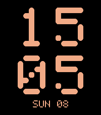

# Transit

*A split-flap transit display for your wrist, in six classic colour schemes.*

 

A Pebble watchface (v1.0.0) for Pebble Time 2 (emery) and Pebble Round 2 (gabbro).

Transit shows the hours and minutes as two big dot-matrix lines, with generous
space between the digits so they stay readable at a glance. A third line can
show the date, today's steps, your heart rate, or the day's low and high
temperature.

All characters are drawn in code as a 5x7 dot matrix. Neighbouring dots merge
into segments, which gives the blocky, mechanical look of a flip-dot display
without any image resources.

## Features

- Hours and minutes in a large 5x7 dot matrix, two digits per line.
- Third line: date (MON 14), steps, heart rate, or low/high temperature.
- Six colour themes mapped to Pebble's 64-colour palette:
  - Classic Amber - amber on black.
  - Neon Green - bright green on black.
  - High-Contrast Cyan - cyan on dark navy.
  - Bi-Color Flip Dot - lemon yellow on dark grey.
  - Monochrome White - white on black.
  - Monochrome Inverse - graphite on light grey.
- 12 or 24 hour format follows the watch setting; 12 hour mode shows a small
  A or P marker.
- Layout adapts to the rectangular Emery and the round Gabbro screen.
- Settings are applied live from the phone and persist across restarts.

## Settings

- **Colour theme** - one of the six schemes above.
- **Third line** - date, steps, heart rate, or low/high temperature.
- **Temperature unit** - automatic (phone region), Celsius or Fahrenheit.

Heart rate needs a watch with a heart-rate sensor; Pebble Round 2 shows `--`
for that line. Low and high temperature come from
[Open-Meteo](https://open-meteo.com/) for your current location and are
refreshed every 30 minutes.

## Building

Requires the [Pebble SDK](https://developer.rebble.com/sdk/).

```bash
pebble build
pebble install --emulator gabbro
```

## Release notes

### 1.0.0

First release.

## License

MIT, see [LICENSE](LICENSE).

## Status

- v1.0.0: Dot-matrix time, six themes, date/steps/heart/temperature line and
  Clay settings implemented for emery and gabbro.
- Store copy, three screenshot presets and icons are in place.
- Live weather could not be verified in the emulator: pypkjs geolocation
  stalls, so the store screenshots use the built-in demo values. The watch
  itself asks for weather through the phone's location; the request path is
  unchanged from other projects that use Open-Meteo.
- Open: publish to the Rebble App Store.
